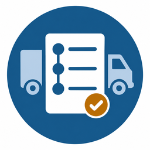

<p align="center"></p>

# aktura-etrn — «Кто есть кто в ЭТрН»

**Справочный помощник по электронной транспортной накладной.** Пользователь описывает перевозку. Помощник определяет,
кто в ней грузоотправитель, грузополучатель, перевозчик, экспедитор и лицо, осуществляющее погрузку (ЛОП), нужна ли
ЭТрН или допустима бумага и кто какой титул подписывает. Каждый вывод — со ссылкой на норму и степенью уверенности.

**Попробовать:** сайт [aktura.ru](https://aktura.ru) · Telegram [@AkturaBot](https://t.me/AkturaBot?start=github) ·
MAX [«Актура»](https://max.ru/id6140010377_3_bot?start=github)

[](LICENSE)
[](https://claude.com/claude-code)

---

## Главный принцип: ИИ ничего не решает

Роли и выводы выдаёт только детерминированный движок по базе правил. Языковая модель лишь предлагает ответы на
вопросы опросника по описанию «своими словами». Предложение принимается, только если к нему приложена дословная
цитата из текста пользователя, и человек подтверждает его галочкой. Без ключа модели помощник работает как обычный
опросник.

```text
 описание своими словами ──► ИИ-слой (необязательно) ──► предложенные ответы с цитатами
                                                               │  человек подтверждает галочками
                                                               ▼
 вопросы опросника ◄──────── quiz: какой факт нужен ◄──── факты (rules/VOCABULARY.md)
        │ ответ / «Не знаю» / «Назад»                          ▲
        └──────────────────────────────────────────────────────┘
                                                               │
                                                               ▼
                                   engine: детерминированный движок по rules/rules.yaml
                                                               │
                                                               ▼
                    роли · нужна ли ЭТрН · форма (электронная / бумага) · кто подписывает титулы
                    · экспедиторские документы · ссылки на нормы · степень уверенности
```

## Нормы как данные

Правила записаны в YAML и меняются без пересборки. У каждого правила — источники: акт, дословная цитата до 25 слов,
ссылка на официальный текст и дата сверки. База 0.7.0 от 30.09.2026, 40 правил:

| Слой | Что определяет | Правил |
| --- | --- | ---: |
| `roles` | роли участников и нужна ли транспортная накладная | 17 |
| `signers` | кто подписывает титулы, если груз за получателя принимает представитель | 1 |
| `form` | электронная или бумажная (исключения приказа Минтранса № 262) | 13 |
| `fwd_docs` | нужны ли экспедиторские документы (87-ФЗ ст. 2, ПП 469) | 3 |
| `fwd_form` | их форма (исключения приказа Минтранса № 115) | 6 |

Уверенность: **35** `clear`, **4** `disputed`, **1** `unknown`.

- **`clear`** — ответ прямо следует из нормы.
- **`disputed`** — источники расходятся. Помощник показывает обе позиции с источниками и не выбирает между ними.
  Пример — R-113: доставка гражданину по заказу магазина и исключение п. 4 приказа Минтранса № 262.
- **`unknown`** — источника нет. Помощник так и говорит.

Если правилу не хватает факта, движок не угадывает, а задаёт вопрос. Порядок применения слоёв и словарь фактов —
[rules/VOCABULARY.md](rules/VOCABULARY.md).

**Откуда берутся нормы** — строго по порядку: законы и подзаконные акты с официальных порталов и из СПС; судебная
практика с юридической силой (Пленум и обзоры ВС РФ, определения ВС РФ, постановления арбитражных судов округов —
с номером дела, сверенные по тексту); разъяснения ведомств — только как дополнение к норме. Форумы, блоги,
материалы вендоров и ответы ИИ источниками не являются. Реестр актов — [rules/SOURCES.md](rules/SOURCES.md), снимки
официальных текстов с датой снятия — [sources/](sources/).

> В заметках правил, в реестре и снимках встречаются ссылки на рабочие исследования (`research/…`) и номера
> открытых вопросов (`QUESTIONS №…`). Это внутренние материалы проекта, в репозиторий они не входят; первоисточники
> указаны в самих правилах и снимках.

## Тесты

```sh
go test ./...
```

- [rules/tests.yaml](rules/tests.yaml) — 67 тест-кейсов, минимум один на правило.
- [rules/golden.yaml](rules/golden.yaml) — золотой набор: 57 реальных ситуаций с форумов бухгалтеров и
  перевозчиков, пересказанных без имён. Ответы форумов — не источник правил, только материал для тестов.
- Инварианты базы: у каждого правила есть тест и источники, цитата не длиннее 25 слов, ключи — из словаря, в слое
  ролей на любое сочетание фактов срабатывает ровно одно правило.
- Симуляция опроса: сайт и боты проходят все кейсы до результата, каждый вопрос бота помещается в одно сообщение.

**ИИ-слой** проверяется отдельно, на золотом наборе. Критерий допуска — **0 уверенных ошибок** (ИИ уверенно
предложил не тот ответ):

```sh
# без -run — только подсчёт запросов (запросы к модели платные)
AKTURA_LLM=yandex YANDEX_API_KEY=... YANDEX_FOLDER_ID=... go run ./cmd/aktura-eval
go run ./cmd/aktura-eval -only G-001,G-002 -run -v
```

## Быстрый старт

Нужен Go 1.26+.

```sh
go run ./cmd/aktura -addr :8080     # опросник на http://localhost:8080
```

Или в контейнере: `docker build -t aktura-etrn . && docker run -p 8080:8080 aktura-etrn`.

Без переменных окружения сервер работает в минимальном режиме: только опросник и результат, без ИИ-слоя, Метрики,
журнала и ботов.

| Флаг | По умолчанию | Назначение |
| --- | --- | --- |
| `-addr` | `:8080` | адрес HTTP-сервера |
| `-rules` | `rules/rules.yaml` | база правил |
| `-questions` | `rules/questions.yaml` | вопросы опросника |
| `-data` | пусто | каталог журнала ситуаций и отзывов; пусто — журнал не ведётся |
| `-ai-per-minute` | `20` | общий предел разборов описаний в минуту |
| `-ai-per-day` | `50` | общий предел в сутки — потолок расходов на модель |
| `-probe` | пусто | проверить `/healthz` по адресу и выйти (healthcheck контейнера) |

| Переменная | Для чего |
| --- | --- |
| `AKTURA_OPERATOR`, `AKTURA_CONTACT`, `AKTURA_OPERATOR_ADDRESS` | реквизиты оператора ПДн. Без них сервер не включит Метрику и ИИ-слой, а процесс с токенами ботов не запустится |
| `AKTURA_METRIKA_ID` | Яндекс Метрика: включается только после согласия посетителя, без Вебвизора |
| `AKTURA_LLM` | `yandex` или пусто (режим без ИИ). `gigachat` на сайте запрещён: условия GigaChat не допускают передачу ПДн третьих лиц; его можно использовать только в `aktura-eval` |
| `YANDEX_API_KEY`, `YANDEX_FOLDER_ID`, `YANDEX_MODEL` | YandexGPT (по умолчанию `yandexgpt/latest`) |
| `GIGACHAT_AUTH_KEY`, `GIGACHAT_SCOPE`, `GIGACHAT_MODEL`, `GIGACHAT_CA_FILE` | GigaChat для `aktura-eval` |
| `AKTURA_MAX_TOKEN`, `AKTURA_TG_TOKEN` | токены ботов MAX и Telegram |
| `AKTURA_TG_PROXY` | прокси для Telegram (`socks5://…`) |
| `AKTURA_MAX_BOT_URL`, `AKTURA_TG_BOT_URL` | ссылки на ботов на сайте |
| `AKTURA_SITE` | адрес сайта в сообщениях бота |
| `AKTURA_BOT_SOURCES` | разрешённые метки источника в ссылках `?start=…` через запятую |

Боту MAX нужны корневые сертификаты Минцифры — как их положить, описано в
[bot/maxbot/cacert/README.md](bot/maxbot/cacert/README.md).

## Интерфейсы

- **Сайт** ([web/](web/)) — опросник без JavaScript. Состояние на сервере не хранится, всё передаётся в форме.
- **Боты** ([bot/](bot/)) — тот же опросник кнопками в MAX и Telegram, в одном процессе с сайтом. Свободный текст
  боты не принимают. Состояние — в памяти по ID пользователя 24 часа; в журналы ID не пишется.

## Персональные данные

- Журнал ситуаций хранит ответы на вопросы опросника, без ПДн; отзывы «В моей ситуации это не так» — отдельно.
  Записи старше 12 месяцев сервис удаляет сам.
- Описание для ИИ и комментарий к отзыву не предназначены для ПДн: форма просит описывать перевозку, а не людей.
  Описание уходит на разбор модели и на сервере не сохраняется.
- Политика обработки ПДн и согласия — [web/legal/](web/legal/). Новая редакция — новый файл `*.vN.txt`.

## Структура

```text
engine/          детерминированный движок (слои roles, signers, form, fwd_docs, fwd_form)
quiz/            выбор следующего вопроса
present/         переходы опроса и подписи результата — общее для сайта и ботов
extract/         ИИ-слой: описание → предложенные факты с цитатами
llm/             клиенты YandexGPT и GigaChat (HTTP, без SDK)
web/             сайт, политика и согласия (web/legal/)
bot/             боты MAX (bot/maxbot/) и Telegram (bot/tgbot/)
store/           журнал ситуаций и отзывы (JSONL)
cmd/aktura/      запуск сервера
cmd/aktura-eval/ проверка ИИ-слоя на золотом наборе
rules/           база правил, словарь, вопросы, тесты, золотой набор, реестр актов
sources/         снимки официальных текстов с датой снятия
```

## Чем помощник не является

- Он не оформляет и не отправляет ЭПД и не подключается к операторам и ГИС ЭПД.
- Он **не даёт юридических гарантий**. Это справочник со ссылками на нормы; где правила неоднозначны, он показывает
  позиции и не решает за пользователя. База — черновик: правила сверены с источниками, но проверку юристом не
  проходили.

## Авторство и лицензия

Автор — [RunetX](https://github.com/RunetX). Проект сделан вместе с ИИ-агентом
[Claude Code](https://claude.com/claude-code) (Anthropic): код, поиск и сверка норм. Задачи, решения и проверка —
за автором.

Лицензия — [GNU AGPL v3](LICENSE): код можно использовать и менять, но если вы запускаете изменённую версию как
сервис, её исходный код нужно открыть пользователям.

Этот репозиторий — публичная копия рабочего, обновляется выгрузкой. Ошибку в правиле лучше всего показать ситуацией:
issue с описанием перевозки (без имён и реквизитов) или отзыв «В моей ситуации это не так» на [aktura.ru](https://aktura.ru).
